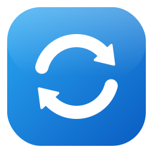

<p align="center"></p>

# SyncToyNext

**SyncToyNext** ist ein freier Nachbau von **Microsoft SyncToy 2.1** für Windows 10 und 11.

SyncToy war ein kleines, beliebtes Werkzeug, mit dem man zwei Ordner abgleichen konnte, zum Beispiel
den Dokumente-Ordner mit einer externen Festplatte oder einem USB-Stick. Microsoft pflegt es seit
vielen Jahren nicht mehr, und es lässt sich nicht mehr offiziell herunterladen. SyncToyNext bildet
Bedienung und Verhalten von SyncToy 2.1 möglichst genau nach, basiert auf aktuellem .NET 10, hat eine
moderne Oberfläche im Windows-11-Stil und ist quelloffen (MIT-Lizenz).

> SyncToyNext ist ein unabhängiges Projekt und steht in keiner Verbindung zu Microsoft.
> „SyncToy“ ist eine Marke von Microsoft.

---

## Funktionen

- **Ordnerpaare:** beliebig viele benannte Paare aus einem linken und einem rechten Ordner,
  einzeln oder gemeinsam über **„Alle ausführen“** startbar.
- **Drei Aktionen wie im Original:**

  | Aktion | Neue/geänderte Dateien | Umbenennungen | Löschungen | Änderungen rechts |
  |---|---|---|---|---|
  | **Synchronize** | in beide Richtungen | in beide Richtungen | in beide Richtungen | werden übernommen |
  | **Echo** | links → rechts | links → rechts | links → rechts | werden ignoriert |
  | **Contribute** | links → rechts | links → rechts | keine | werden ignoriert |

- **Vorschau:** zeigt jede geplante Aktion mit Begründung, bevor etwas verändert wird. Einzelne
  Aktionen lassen sich abwählen. Abgewählte Aktionen werden beim nächsten Lauf erneut angeboten.
- **Umbenennungen und Verschiebungen** von Dateien und ganzen Ordnern werden erkannt und auf der
  anderen Seite nachvollzogen, statt alles neu zu kopieren und das Original zu löschen. Das gilt auch
  für reine Änderungen der Groß-/Kleinschreibung (z. B. `bericht.txt` → `Bericht.txt`).
- **Papierkorb:** überschriebene und gelöschte Dateien landen standardmäßig im Windows-Papierkorb.
- **Filter:** einzuschließende und auszuschließende Dateien (z. B. `*.docx; *.xlsx` oder `*.tmp; ~$*`),
  ausgeschlossene Unterordner sowie das Ausschließen schreibgeschützter, versteckter oder Systemdateien.
- **Dateiinhalte prüfen:** auf Wunsch Byte-für-Byte-Vergleich statt nur Größe und Änderungsdatum.
- **Kommandozeile** `SyncToyNextCmd.exe` für die Windows-Aufgabenplanung, wie `SyncToyCmd.exe`.
- **Protokoll** aller Läufe unter `%LOCALAPPDATA%\SyncToyNext\SyncToyNextLog.txt`.

### Oberfläche

- **Windows-11-Design** mit abgerundeten Ecken und Akzentfarbe. Hell- und Dunkelmodus folgen
  automatisch der Windows-Einstellung.
- **Übersicht** je Ordnerpaar: linker Ordner → Aktion → rechter Ordner, aktive Optionen auf einen Blick
  und ein Hinweis, wenn ein Ordner nicht erreichbar ist (z. B. USB-Laufwerk nicht angeschlossen).
- **Vorschau** mit Zusammenfassung, Suche und Filter (z. B. „Nur Fehler“). Ein Doppelklick zeigt die
  Datei im Explorer.
- **Ausführlicher Fortschritt beim Ausführen:** Aktion x von y, kopierte Menge, Tempo (MB/s), geschätzte Restzeit
  und bei großen Dateien ein eigener Balken für die laufende Datei. Die Tabelle blättert auf Wunsch mit.
- **Fortschritt in der Taskleiste**, damit man ihn auch bei minimiertem Fenster sieht.
- **Drag & Drop:** Zieht man zwei Ordner aus dem Explorer auf das Fenster, entsteht ein neues Paar.
  Ordner lassen sich auch in die Pfadfelder ziehen.
- **Tastenkürzel** und Kontextmenüs (siehe unten). Fenstergröße und -position werden gespeichert.

### Zusätzliche Sicherheit gegenüber dem Original

- **Leeres Laufwerk:** Ist eine Seite plötzlich komplett leer, obwohl sie beim letzten Lauf Dateien
  enthielt (typisch: falscher USB-Stick angesteckt), fragt SyncToyNext nach, statt auf der anderen
  Seite alles zu löschen. Die Kommandozeile überspringt das Paar in diesem Fall, außer mit `--force`.
- **Änderungen nach der Vorschau:** Hat sich eine Datei zwischen Vorschau und Ausführung verändert,
  wird die betreffende Aktion übersprungen, statt die neue Version zu überschreiben.
- **Kein halbes Kopieren:** Dateien werden zuerst unter einem temporären Namen geschrieben und erst
  danach umbenannt. Ein Abbruch hinterlässt deshalb nie eine halb kopierte Datei unter dem echten Namen.
- **Fehler werden wiederholt:** Fehlgeschlagene oder abgebrochene Aktionen bietet SyncToyNext beim
  nächsten Lauf erneut an.

---

## Herunterladen und installieren

Fertige Programme erzeugt der GitHub-Workflow bei jedem Push automatisch. Bei Versionen mit Tag
(z. B. `v1.1.0`) liegen sie unter **Releases**, sonst unter **Actions** → neuester erfolgreicher
Lauf von **„Build“** → **Artifacts**.

| Datei | Beschreibung |
|---|---|
| **`SyncToyNext-Setup-<Version>.exe`** | **Empfohlen.** Installer mit Startmenü-Eintrag und Deinstallation. Braucht keine Administratorrechte (installiert nach `%LOCALAPPDATA%\Programs\SyncToyNext`); im Setup lässt sich „für alle Benutzer“ wählen. |
| `SyncToyNext-win-x64` | Ohne Installation: ZIP entpacken, beide `.exe` im selben Ordner lassen, `SyncToyNext.exe` starten. Enthält .NET bereits. |
| `SyncToyNext-win-x64-framework` | Sehr klein, benötigt aber die [.NET 10 Desktop Runtime](https://dotnet.microsoft.com/download/dotnet/10.0). |

Windows SmartScreen kann beim ersten Start warnen, weil die Programme nicht signiert sind.
Über „Weitere Informationen“ → „Trotzdem ausführen“ lässt es sich starten.

Bei einer Deinstallation bleiben die Ordnerpaare (`%LOCALAPPDATA%\SyncToyNext`) erhalten, damit sie
nach einer Neuinstallation wieder da sind.

---

## Bedienung

1. **Neues Ordnerpaar …** anklicken, Name, linken und rechten Ordner sowie die Aktion wählen.
   Unter **Optionen** lassen sich Filter und weitere Einstellungen festlegen.
2. **Vorschau** zeigt, was passieren würde. Mit **Ausführen** wird es umgesetzt.
3. Über **Bearbeiten …** lassen sich Paare später ändern. Zeigt ein Paar danach auf andere Ordner,
   beginnt es mit einem neuen Stand, wie bei einem neuen Paar.

### Tastenkürzel

| Taste | Funktion |
|---|---|
| `Strg`+`N` | Neues Ordnerpaar |
| `F2` / `Strg`+`E` | Ordnerpaar bearbeiten |
| `Entf` | Ordnerpaar löschen |
| `Strg`+`P` | Vorschau |
| `F5` | Ausführen |
| `Strg`+`F5` | Alle ausführen |
| `Strg`+`L` | Protokoll öffnen |
| `F1` | Über SyncToyNext |

### Wichtig beim ersten Lauf

Beim ersten Lauf eines Paars kennt SyncToyNext noch keine Vorgeschichte:

- **Synchronize:** Fehlende Dateien werden auf die jeweils andere Seite kopiert. Gibt es eine Datei
  auf beiden Seiten in unterschiedlichen Versionen, gewinnt die **neuere**.
- **Echo/Contribute:** Bei unterschiedlichen Versionen gewinnt die **linke** Seite.

Gelöscht wird beim ersten Lauf nie etwas. Am besten vorher die **Vorschau** ansehen.

---

## Kommandozeile und Zeitsteuerung

Wie bei SyncToy gibt es keinen eingebauten Zeitplaner. Für regelmäßige Läufe startet die
Windows-Aufgabenplanung das Kommandozeilenprogramm. Unter **Extras → Zeitgesteuert ausführen**
zeigt die Oberfläche die passenden Befehle zum Kopieren an.

```text
SyncToyNextCmd -R                 Alle Ordnerpaare ausführen, die für "Alle ausführen" aktiv sind
SyncToyNextCmd -R "Name"          Ein bestimmtes Ordnerpaar ausführen (auch: -R"Name")
SyncToyNextCmd -P ["Name"]        Nur Vorschau anzeigen, nichts ändern
SyncToyNextCmd -L                 Alle Ordnerpaare auflisten
SyncToyNextCmd -?                 Hilfe

--force                           Auch ausführen, wenn eine Seite plötzlich leer ist
--config "Datei"                  Andere Datei mit Ordnerpaaren verwenden
--no-log                          Kein Protokoll schreiben
```

Rückgabewert: `0` = erfolgreich, `1` = Fehler bei mindestens einem Paar, `2` = falscher Aufruf.

---

## So funktioniert der Abgleich

Damit SyncToyNext eine **gelöschte** Datei von einer **neuen** unterscheiden kann, merkt es sich
nach jedem Lauf den Stand beider Ordner. Dafür legt es, wie SyncToy mit seinen `SyncToy_*.dat`,
in jedem der beiden Ordner eine versteckte Datei `SyncToyNext_<Kennung>.dat` an. Diese Dateien
bitte nicht löschen. Ohne sie verhält sich das nächste Ausführen wie ein erster Lauf.

- Eine Datei gilt auf einer Seite als **geändert**, wenn sie neu ist oder sich Größe bzw.
  Änderungszeit gegenüber dem gemerkten Stand geändert haben.
- Beim Vergleich zwischen den beiden Seiten gilt eine Toleranz von 2 Sekunden, weil FAT- und
  exFAT-Datenträger (viele USB-Sticks) Zeiten nur auf 2 Sekunden genau speichern.
- Eine **Umbenennung** wird erkannt, wenn genau eine Datei verschwunden und genau eine neue mit
  identischer Größe und Änderungszeit aufgetaucht ist. Leere Dateien werden dabei nicht berücksichtigt.
- Ein **Ordner** gilt als umbenannt oder verschoben, wenn genau ein neuer Ordner dieselben Dateinamen
  enthält wie der verschwundene (mindestens die Hälfte davon mit gleicher Größe und Änderungszeit).
  Er wird dann auf der anderen Seite in einem Schritt umbenannt. Wurden im umbenannten Ordner zusätzlich
  Dateien geändert, werden diese danach kopiert.
- Wurde eine Datei **auf beiden Seiten** geändert, gewinnt bei Synchronize die neuere Version. Die
  ältere landet im Papierkorb. Haben beide Versionen dieselbe Änderungszeit, wird die Datei
  übersprungen und als Konflikt gemeldet.
- Wurde eine Datei auf einer Seite gelöscht und auf der anderen geändert, gewinnt die Änderung.
- Ordner werden nur gelöscht, wenn sie danach leer sind.

Die Ordnerpaare stehen in `%LOCALAPPDATA%\SyncToyNext\FolderPairs.json`.

### Netzlaufwerke (NAS, Freigaben)

Bei Netzlaufwerken bremst vor allem die Wartezeit pro Anfrage, nicht die Datenmenge. SyncToyNext ist
darauf ausgelegt:

- Beim Einlesen werden mehrere Ordner gleichzeitig abgefragt, beide Seiten parallel, mit großen
  Puffern. Größe, Datum und Attribute kommen direkt aus dem Verzeichnis-Listing, ohne Abfrage je Datei.
  Die Vorschau zeigt laufend, wie viele Einträge schon gelesen sind.
- Nach dem Ausführen werden die Ordner nicht erneut eingelesen. Der neue Stand ergibt sich aus der
  Vorschau und den erfolgreich ausgeführten Aktionen.
- Kopiert wird mit derselben Windows-Funktion wie im Explorer (`CopyFileEx`). Pro Datei sind nur
  wenige zusätzliche Abfragen nötig, und bereits angelegte Zielordner werden gemerkt.
- Die Oberfläche greift nie direkt auf Netzwerkpfade zu. Antwortet ein Laufwerk nicht, erscheint ein
  Hinweis, statt dass das Fenster einfriert.

Die Option **„Dateiinhalte prüfen“** liest Dateien, die auf beiden Seiten vorkommen, vollständig über
das Netzwerk. Bei großen Datenmengen auf einem NAS sollte sie deshalb nur bei Bedarf aktiv sein.

---

## Bekannte Einschränkungen

- **Papierkorb:** Auf Laufwerken ohne Papierkorb (Netzwerkfreigaben, viele USB-Sticks) löscht
  Windows endgültig. Das war bei SyncToy genauso.
- **Sommer-/Winterzeit:** Auf FAT-Datenträgern können sich Zeitstempel bei der Zeitumstellung um eine
  Stunde verschieben. Dann werden Dateien unnötig erneut kopiert. Auch das trat bei SyncToy auf.
- **Kein Import:** Ordnerpaare aus dem originalen SyncToy werden nicht übernommen.

---

## Selbst bauen

Voraussetzung ist das [.NET 10 SDK](https://dotnet.microsoft.com/download/dotnet/10.0).

```powershell
dotnet build SyncToyNext.sln
dotnet test SyncToyNext.sln
dotnet run --project src/SyncToyNext.App
```

Fertige Einzeldateien wie im Workflow:

```powershell
dotnet publish src/SyncToyNext.App -c Release -r win-x64 --self-contained true -p:PublishSingleFile=true -o out
dotnet publish src/SyncToyNext.Cmd -c Release -r win-x64 --self-contained true -p:PublishSingleFile=true -o out
```

### Projektaufbau

| Projekt | Inhalt |
|---|---|
| `src/SyncToyNext.Core` | Sync-Engine ohne Oberfläche: Einlesen, Filter, Statusdateien, Planung, Ausführung, Papierkorb, Protokoll |
| `src/SyncToyNext.App` | WPF-Oberfläche (`SyncToyNext.exe`) |
| `src/SyncToyNext.Cmd` | Kommandozeile (`SyncToyNextCmd.exe`) |
| `tests/SyncToyNext.Core.Tests` | Automatische Tests der Engine mit echten Ordnern |
| `installer/SyncToyNext.iss` | Installer (Inno Setup 6.3 oder neuer) |
| `assets/make_icon.py` | Erzeugt Logo und Programmsymbol (`pip install cairosvg pillow`) |

Der Workflow startet die Oberfläche außerdem mit `SyncToyNext.exe --smoke-test`. Dabei öffnet sie
alle Fenster mit Testdaten, erstellt eine echte Vorschau und beendet sich mit Rückgabewert 0 oder 1.

---

## Lizenz

[MIT](LICENSE)
